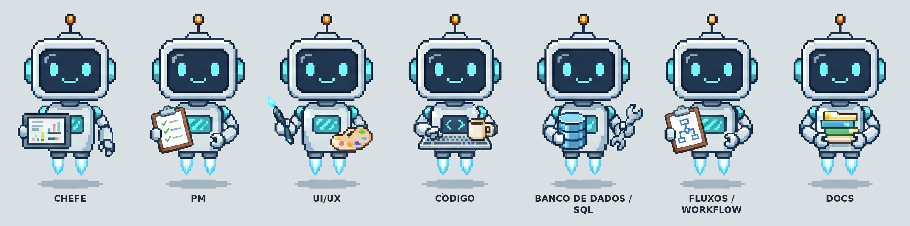

# EFCsys Bots

A equipe de robozinhos da EFCsys. Você fala só com o **Chefe**, que passa o pedido pela equipe na ordem do fluxo e te devolve o resultado.



## A equipe, na ordem do fluxo

| # | Robô | Faz o quê | Equipamento |
|---|------|-----------|-------------|
| 1 | **Chefe** | Recebe o pedido, coordena a equipe e entrega o resultado | Tablet com gráficos |
| 2 | **PM** | Quebra o pedido em tarefas, requisitos e prioridades | Prancheta com checklist |
| 3 | **UI/UX** | Cores, tipografia, logo e telas, sem cara de IA | Caneta gráfica e paleta |
| 4 | **Código** | Escreve o código e implementa as telas | Teclado e caneca de café |
| 5 | **Banco de Dados / SQL** | Tabelas, consultas, migrations e RLS no Supabase | Cilindro de banco e chave inglesa |
| 6 | **Fluxos / Workflow** | Automações, integrações e tarefas em segundo plano | Prancheta com fluxograma |
| 7 | **Docs** | Organiza entregas, documentação e arquivos | Pilha de pastas |

O fluxo completo está em [docs/fluxo.md](docs/fluxo.md).

## Expressões

Todos os robôs usam os mesmos 8 rostos. Só a tela muda; o corpo e o equipamento ficam iguais.

`dormindo` · `acordando` · `feliz` · `repouso` · `pensando` · `trabalhando` · `erro` · `sucesso`


## O que tem aqui

```
app/                  App PWA (estático, instalável no celular)
  sprites/            Os 56 robôs em WebP leve (7 robôs x 8 expressões)
  icons/              Ícones do app
assets/
  sprites/            Os 56 robôs em PNG com fundo transparente, tamanho original
  folhas/             Folha da equipe e folha de expressões
  referencias/        Imagens de referência do Eric (rosto padrão, expressões, fluxo)
docs/                 Fluxo de trabalho e padrão visual dos robôs
ferramentas/          Script que monta os sprites a partir das referências
```

Nome dos sprites: `funcao_estado`, por exemplo `banco_trabalhando.png`.
Funções: `chefe`, `pm`, `uiux`, `codigo`, `banco`, `fluxos`, `docs`.

## Rodar o app

É um site estático, sem build:

```bash
cd app
python3 -m http.server 8080
# abrir http://localhost:8080
```

### Publicar no GitHub Pages

O workflow `.github/workflows/pages.yml` publica a pasta `app/` a cada push na `main` e grava a versão e o commit no rodapé do app.
Uma vez só: em **Settings › Pages**, escolha **Source: GitHub Actions**.

### Nova versão

Ao mudar o app, aumente `VERSAO` em `app/sw.js`. Quem já tem o app instalado vê o aviso "Tem uma versão nova do app" e atualiza com um toque.

## Refazer os sprites

Se as imagens de referência mudarem, troque os arquivos em `assets/referencias/` e rode:

```bash
pip install pillow numpy scipy
python3 ferramentas/montar_sprites.py
```

O script pega o corpo de cada robô da imagem de rosto padrão, encaixa as 8 expressões da imagem de expressões no visor e salva os PNGs e as folhas. Depois, para atualizar o app, gere os WebP de novo (ver `ferramentas/gerar_webp.py`).

---

by: efcsys
