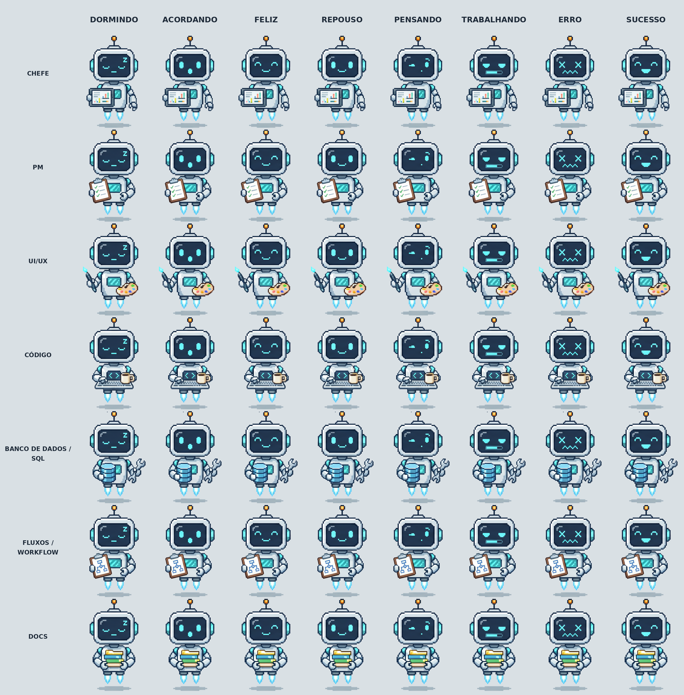

# EFCsys Bots

A equipe de robozinhos da EFCsys. Você fala só com o **Chefe**, que passa o pedido pela equipe na ordem do fluxo e te devolve o resultado.


## A equipe, na ordem do fluxo

| # | Robô | Faz o quê | Equipamento |
|---|------|-----------|-------------|
| 1 | **Chefe** | Recebe o pedido, coordena a equipe e entrega o resultado | Tablet com gráficos |
| 2 | **PM** | Quebra o pedido em tarefas, requisitos e prioridades | Prancheta com checklist |
| 3 | **UI/UX** | Cores, tipografia, logo e telas, sem cara de IA | Caneta gráfica e paleta |
| 4 | **Código** | Escreve o código e implementa as telas | Teclado e caneca de café |
| 5 | **Banco de Dados / SQL** | Tabelas, consultas, migrations e RLS no Supabase | Cilindro de banco e chave inglesa |
| 6 | **Fluxos / Workflow** | Automações, integrações e tarefas em segundo plano | Prancheta com fluxograma |
| 7 | **Docs** | Organiza entregas, documentação e arquivos | Pilha de pastas |

O fluxo completo está em [docs/fluxo.md](docs/fluxo.md).

## Expressões

Todos os robôs usam os mesmos 8 rostos. Só a tela muda; o corpo e o equipamento ficam iguais.

`dormindo` · `acordando` · `feliz` · `repouso` · `pensando` · `trabalhando` · `erro` · `sucesso`



## O app

Você entra com **usuário ou e-mail** e senha, escreve o pedido para o **Chefe**, e ele decide quem da equipe resolve. Na tela você acompanha cada robô mudando de expressão enquanto trabalha (pensando, trabalhando, terminou) e recebe a entrega de cada um num cartão, com botão de copiar nos blocos de código. A conversa fica salva.

Nesta versão os robôs não mexem em repositórios nem em bancos: entregam planos, código e SQL para você revisar. Ligar o Código ao GitHub e o Banco de Dados a um projeto real é a próxima etapa.

## O que tem aqui

```
server/               Servidor Node.js: login, conversa e o Chefe distribuindo tarefas
  equipe.js           Instruções de cada robô e a orquestração do Chefe
  auth.js             Login por usuário ou e-mail, sessão segura em cookie
  db.js               Tabelas no PostgreSQL (criadas sozinhas na primeira vez)
  criar-admin.js      Cria o Administrador Master pelo terminal
  teste.js            Teste de ponta a ponta (API do Claude simulada)
app/                  App PWA (instalável no celular)
  sprites/            Os 56 robôs em WebP leve (7 robôs x 8 expressões)
assets/
  sprites/            Os 56 robôs em PNG com fundo transparente, tamanho original
  folhas/             Folha da equipe e folha de expressões
  referencias/        Imagens de referência do Eric (rosto padrão, expressões, fluxo)
docs/                 Fluxo de trabalho e padrão visual dos robôs
ferramentas/          Scripts que montam os sprites a partir das referências
Dockerfile            Imagem para a Shard Cloud
```

Nome dos sprites: `funcao_estado`, por exemplo `banco_trabalhando.png`.
Funções: `chefe`, `pm`, `uiux`, `codigo`, `banco`, `fluxos`, `docs`.

## Publicar na Shard Cloud

1. Na Shard Cloud, crie um banco **PostgreSQL** e copie a URL de conexão.
2. Crie uma **Aplicação** ligada a este repositório, branch `main`. Ela usa o `Dockerfile` da raiz.
3. Cadastre as variáveis de ambiente no painel (nunca no repositório):

| Variável | Para que serve |
|----------|----------------|
| `DATABASE_URL` | URL do PostgreSQL da Shard |
| `ANTHROPIC_API_KEY` | Chave da API do Claude |
| `ADMIN_USUARIO` | Seu usuário de Administrador Master (ex.: `eric`) |
| `ADMIN_SENHA` | Sua senha (mínimo 8 caracteres). Depois do primeiro login, pode apagar |
| `ADMIN_EMAIL` | Opcional: para entrar também pelo e-mail |
| `ANTHROPIC_MODEL` | Opcional: modelo dos robôs (padrão `claude-sonnet-5-5`) |
| `CHEFE_MODEL` | Opcional: modelo só do Chefe |
| `DATABASE_SSL` | Opcional: `false` se o banco não usar SSL |

A porta vem da variável `PORT` que a Shard define. O endereço de saúde é `/health`.

4. Publique e confira nos logs a linha `Administrador Master criado: eric` e depois `EFCsys Bots no ar`.
5. Abra o endereço da aplicação e entre com o seu usuário.

Para criar o Administrador Master pelo terminal em vez das variáveis:

```bash
npm run criar-admin -- --usuario eric --senha "uma-senha-forte" --email voce@exemplo.com
```

Cada pedido usa a API do Claude, e um pedido grande pode chamar até 8 robôs. O servidor aceita um pedido por vez por pessoa.

## Rodar no seu computador

```bash
npm ci
cp .env.example .env    # preencha DATABASE_URL e ANTHROPIC_API_KEY
node --env-file=.env server/index.js
# abrir http://localhost:8080
```

Teste automático (precisa de um PostgreSQL de teste, não gasta créditos):

```bash
TEST_DATABASE_URL=postgres://usuario@127.0.0.1:5432/teste npm test
```

### Nova versão

Ao mudar o app, aumente a versão nos três lugares: `version` em `package.json`, `VERSAO` em `app/sw.js` e `versao` em `app/version.js`. A tela de login mostra essa versão no rodapé (`v0.2.0`), para você conferir se o deploy atualizou. Quem já tem o app instalado vê o aviso "Tem uma versão nova do app" e atualiza com um toque.

## Refazer os sprites

Se as imagens de referência mudarem, troque os arquivos em `assets/referencias/` e rode:

```bash
pip install pillow numpy scipy
python3 ferramentas/montar_sprites.py
```

O script pega o corpo de cada robô da imagem de rosto padrão, encaixa as 8 expressões da imagem de expressões no visor e salva os PNGs e as folhas. Depois, para atualizar o app, gere os WebP de novo (ver `ferramentas/gerar_webp.py`).

---

by: efcsys
