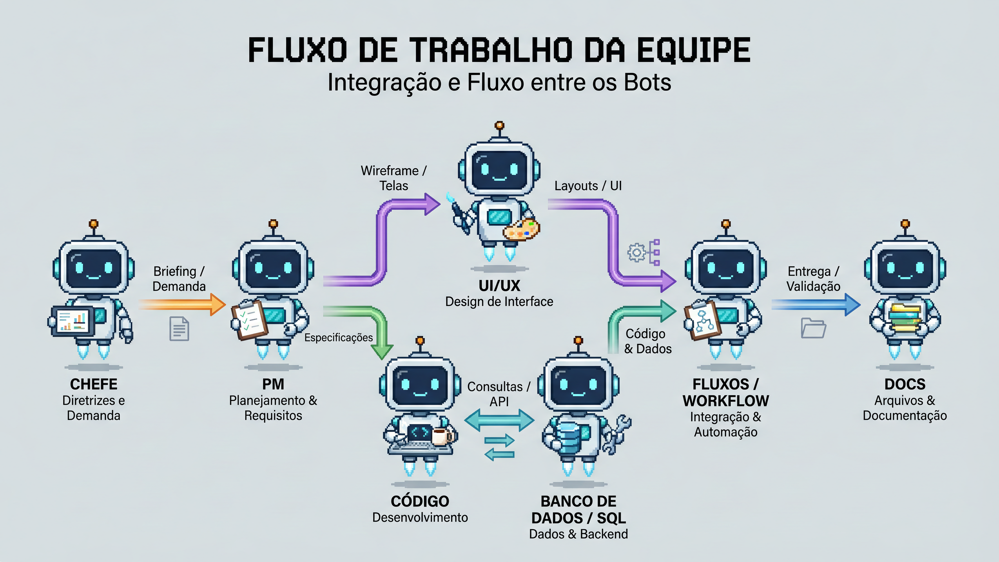

# Fluxo de trabalho da equipe

## Ordem

1. **Chefe** recebe o pedido do Eric e manda o **briefing / demanda** para o PM.
2. **PM** planeja e define os requisitos. Daqui o trabalho se divide:
   - para o **UI/UX**: **wireframe / telas**;
   - para o **Código**: **especificações**.
3. **UI/UX** desenha a interface e passa **layouts / UI** para Fluxos.
4. **Código** desenvolve e conversa com o **Banco de Dados / SQL** nos dois sentidos: **consultas / API**.
5. **Banco de Dados / SQL** cuida dos dados e do backend e passa **código e dados** para Fluxos.
6. **Fluxos / Workflow** integra e automatiza tudo e manda para Docs: **entrega / validação**.
7. **Docs** organiza arquivos e documentação. O Chefe devolve o resultado para o Eric.

## Como o Chefe decide quem resolve

| Assunto | Quem |
|---------|------|
| Planejamento, requisitos e prioridades | PM |
| Visual, logo, tipografia e telas | UI/UX |
| Código, bugs e revisão | Código |
| Tabelas, SQL, RLS e migrations | Banco de Dados / SQL |
| Automações e integrações | Fluxos / Workflow |
| Entrega, documentação e arquivos | Docs |
| Não ficou claro | Pergunta ao Eric |

## Regras de segurança

- O robô de Banco de Dados começa sempre em **só leitura**. Toda mudança vira uma migration que o Eric revisa antes de aplicar.
- Nada vai para um repositório ou banco sem a aprovação do Eric.
